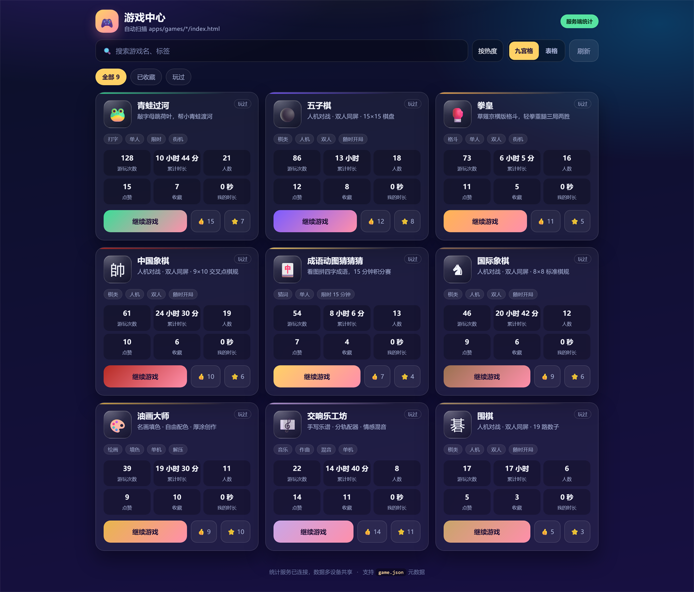
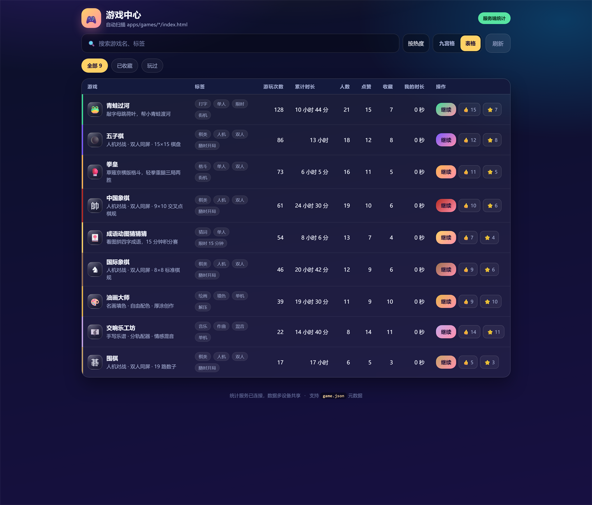

# Build-A-Game

一个纯前端的小游戏合集：9 款原生 JavaScript 写的网页游戏，配一个会自己扫描目录的游戏中心看板。



同一份数据还能切成表格视图，一行一个游戏，六项指标一眼看完：



> 截图为本地运行的实例，统计数字来自 `stats_server.py` 的演示数据。

## 特性

- **两种展示格式**：九宫格卡片（看封面和简介）与表格详情（横向对比指标），选择记在本机浏览器，刷新不丢。
- **统一的检索**：搜索游戏名/标签，筛选「全部 / 已收藏 / 玩过」，按热度、点赞、最新、名称排序；两种视图共用同一套过滤与排序。
- **指标看得见**：游玩次数、累计时长、玩家人数、点赞、收藏、我的时长；玩过的游戏会打标。
- **站内游玩**：点卡片或表格里的「开始」在 iframe 里全屏开局，计时随窗口关闭结算。
- **零依赖**：没有框架、没有构建步骤，双击 `index.html` 就能玩。
- **顺手加游戏**：往目录里丢一个 `<id>/index.html`，扫一遍清单就出现在看板上，`game.json` 可自定义标题、封面、标签、主色。

## 快速开始

```bash
python stats_server.py          # 默认 http://127.0.0.1:8765/
python stats_server.py --port 9000 --host 0.0.0.0   # 手机同网段也能玩
```

它同时做两件事：静态托管本目录，并提供 `/api/stats` 聚合各游戏的游玩次数、时长、人数、点赞与收藏（数据落在 `.stats/stats.json`，不入版本库）。

不装 Python 也可以：直接双击 `index.html`，统计接口 404 时页面会自动降级成本机统计（localStorage）。

## 游戏一览

| 游戏 | 玩法 | 标签 |
| --- | --- | --- |
| [国际象棋](chess/index.html) | 标准 8×8，含王车易位、吃过路兵、兵升变、三次重复与 50 回合和棋 | 棋类 · 人机 · 双人 |
| [中国象棋](xiangqi/index.html) | 9×10 交叉点，含蹩马腿、塞象眼、炮打隔子、飞将 | 棋类 · 人机 · 双人 |
| [围棋](go/index.html) | 19 路，气与整块提子、单劫禁手、中国规则数子（黑贴 7.5 目） | 棋类 · 人机 · 双人 |
| [五子棋](gomoku/index.html) | 15×15，横竖斜连五即胜，可悔棋、认输 | 棋类 · 人机 · 双人 |
| [青蛙过河](frog-typing/index.html) | 敲字母跳荷叶，连击倍率、金币加分，三档难度 | 打字 · 单人 · 街机 |
| [拳皇](kof/index.html) | 草薙京横向格斗，轻拳/重腿/防御/跳跃，60 秒三局两胜 | 格斗 · 单人 · 双人 |
| [成语动图猜猜猜](idiom-anim/index.html) | 看图拼四字成语，15 分钟积分赛 | 猜词 · 单人 · 限时 |
| [油画大师](oil-painting/index.html) | 30 幅名画分区填色，贴合度评星，解锁厚涂笔刷与金箔 | 绘画 · 填色 · 解压 |
| [交响乐工坊](symphony/index.html) | 主谱写旋律自动分轨，11 件乐器配器与情感混音 | 音乐 · 作曲 · 混音 |

## 目录结构

```
index.html        游戏中心页面（看板 / 玩家窗口 / 空态）
center.css        看板样式：卡片网格、表格视图、播放器、响应式
center.js         看板逻辑：渲染、搜索筛选排序、点赞收藏、时长统计、双视图切换
config.js         运行时配置：统计接口、刷新间隔、是否运行时扫描目录
games.js          游戏清单（由脚本生成，浏览器直接 <script> 加载）
games.json        同一份清单的 JSON 版（给脚本 / CI 用）
stats_server.py   静态托管 + /api/stats 统计服务（Python 标准库）
tools/            scan-games.cjs：扫描 <id>/index.html 生成清单
tests/            看板冒烟、清单校验、统计服务单测
docs/             README 里的截图
<game-id>/        每款游戏一个目录，入口 index.html，可选 game.json 元数据
```

## 新增一款游戏

1. 新建 `<game-id>/index.html`（自包含的 HTML/CSS/JS 即可）。
2. 可选：在同目录放 `game.json` 描述元数据。

```json
{
  "title": "游戏名",
  "subtitle": "一句话玩法",
  "description": "详情，表格视图与卡片都用得到",
  "tags": ["分类", "单人"],
  "cover": "🎮",
  "accent": "#7c5cff",
  "version": "0.1.0"
}
```

3. 重新生成清单并刷新看板：

```bash
node tools/scan-games.cjs            # 生成 games.js + games.json
node tools/scan-games.cjs --check    # 校验清单是否与目录一致（CI 用）
```

## 开发与测试

```bash
node tests/scan-games.test.cjs       # 清单扫描
node tests/center.smoke.cjs          # 看板：双视图、筛选、点赞、持久化
python tests/test_stats_server.py    # 统计服务：聚合、校验、落盘
```

## 统计接口

```
GET  /api/stats   -> {"updatedAt": "...", "games": {"<id>": {"plays", "seconds", "people", "likes", "favs"}}}
POST /api/stats   -> {"playerId": "...", "gameId": "...", "type": "open|close|like|unlike|favorite|unfavorite", "seconds": 123}
```

无鉴权，只面向本机 / 内网，请不要直接暴露到公网。
